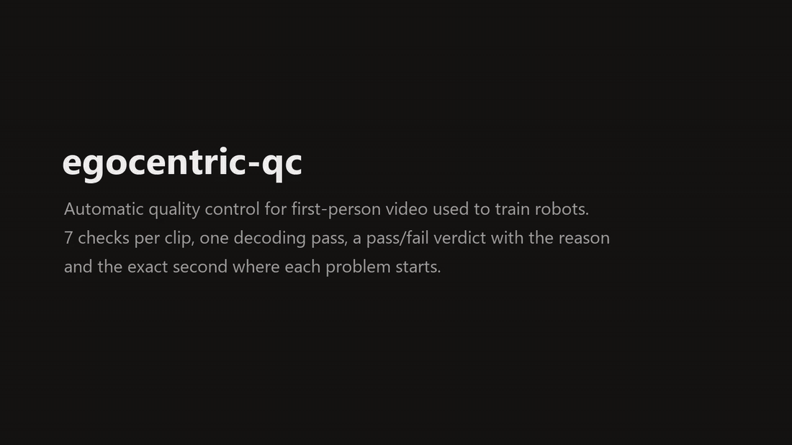

# egocentric-qc

**Automatic quality control for first-person (egocentric) video used as robot training data.**

Robots learn manipulation from video of people doing tasks, filmed from a head or chest camera.
A single bad clip (soft focus, dropped frames, a stalled camera, hands out of view) teaches the
wrong thing, and nobody can watch thousands of hours by hand. `egocentric-qc` reads every clip
once, runs seven checks, and gives each clip a pass/fail verdict with the reason and the exact
second where each problem starts. A Streamlit dashboard shows the results to people who will
never read the code.

### Demo (73 s): the CLI run, then a dashboard walkthrough



The same demo as a video file: [`docs/demo.mp4`](docs/demo.mp4)

## What it checks

| Check | Question it answers | How | Fails when |
| --- | --- | --- | --- |
| **Spec** | Is it the resolution and frame rate we asked for? | measured from the decoded video | below 1920x1080, or fps not 30 ± 0.1 |
| **Corrupt file** | Can the whole file be decoded? | decode every 30th frame up to the length the header promises | any promised frame cannot be reached or decoded |
| **Frame drops** | Are frames missing? | gaps between the stored timestamps of every frame | more than 1% of frames lost |
| **Frozen video** | Did the picture stop changing? | difference between each sampled frame and the next frame | more than 5% of samples frozen |
| **Blur** | Are frames sharp enough? | variance of the Laplacian | more than 10% of samples blurry |
| **Exposure** | Too dark or blown out? | mean gray level | more than 10% of samples outside 40-215 |
| **Hands in view** | Are the hands in the shot? | MediaPipe hand landmarker | more than 50% of samples show no hand |

Every threshold lives in [`config.yaml`](config.yaml), never in code. How each check works, why
the threshold is where it is, and what each check cannot see: [`docs/CHECKS.md`](docs/CHECKS.md).

Measured results on real and synthetic data: [`RESULTS.md`](RESULTS.md).

## Quickstart

Needs Python 3.12, [uv](https://docs.astral.sh/uv/), and ffmpeg (only for the demo set).

    uv sync

    # data (git-ignored): the sample set is ~4 GB, the labelled set ~54 GB
    python -m scripts.download_data             # metadata + pose for both Humanola sets (see DATASETS.md)
    python -m scripts.download_sample_video     # the sample set names its camera main_stereo_left

    # model (git-ignored): MediaPipe hand landmarker, saved as models/hand_landmarker.task
    # https://storage.googleapis.com/mediapipe-models/hand_landmarker/hand_landmarker/float16/latest/hand_landmarker.task

    python -m egoqc list  data/humanola_sample      # every clip with its metadata
    python -m egoqc check data/humanola_sample      # run all checks, write the results table
    streamlit run dashboard/app.py                  # open the dashboard (http://localhost:8501)

Demo set with known defects, to see every check fire:

    python -m scripts.make_demo_set                 # 8 clips from one real clip, 7 deliberately damaged
    python -m egoqc check data/demo

Tests: `uv run pytest` (102 tests; the few that run MediaPipe skip if the model is missing).

### `check` options

    python -m egoqc check DATASET [--out FILE.csv] [--limit N] [--config config.yaml]

It writes two files:

- `outputs/report_<dataset>.csv`: one row per clip with the overall verdict, the failed checks,
  and per check a score (`<check>_bad_share`: 0 = clean, NaN = could not be measured), a
  pass flag, a readable note and where the worst stretch starts.
- `outputs/scores_<dataset>.csv`: one row per sampled second with the blur, brightness,
  frozen and hands scores, which the dashboard draws as timelines.

## Dashboard

`streamlit run dashboard/app.py` reads the CSVs in `outputs/`; it never re-runs the checks, so
it starts instantly. The repo ships the reports for the demo and sample sets, so the dashboard
works right after cloning (the frame previews need the videos in `data/`).

- **Overview**: clips checked, passed, failed, minutes of footage.
- **Failures by check**: which problems are most common.
- **Clips table**: every clip, what it is (task label from the dataset), verdict, failed checks.
- **Clip detail**: one card per check with its note, the actual frame where the problem
  starts, and per-second charts of sharpness, brightness, motion and hands with the threshold
  drawn in and failing seconds marked.

## How it works

```
data/<dataset>/            LeRobot-layout dataset (meta/info.json, meta/episodes.jsonl, videos/)
      │
      ▼
egoqc/loaders/humanola.py  yields one Clip per episode: path, fps, resolution, duration, error
      │                    (missing or unopenable files are yielded with `error` set, never raised)
      ▼
egoqc/checks/scan.py       ONE pass through the video per clip:
      │                      every frame  -> timestamp                      (frame drops)
      │                      every 30th   -> decoded or not                 (corrupt)
      │                      1 per second -> blur, brightness, hands scores
      │                      the frame after each sample -> difference      (frozen)
      ▼
egoqc/checks/<check>.py    each check turns its scores into a CheckResult:
      │                      passed, bad_share, longest bad stretch and where it starts, note
      │                    (shared rule in summary.py: fail only if the share of bad samples is
      │                     above the limit, but always report the longest bad stretch)
      ▼
egoqc/checks/runner.py     one row per clip -> outputs/report_<dataset>.csv + scores_<dataset>.csv
      │
      ▼
dashboard/app.py           Streamlit dashboard on those CSVs
```

Design decisions worth knowing:

- **Decode once.** Running the six video checks separately took 11 min 45 s on the 9 sample
  clips; the single pass takes 2 min 13 s and gives an identical table (tested:
  `test_single_pass_gives_the_same_results_as_each_check_alone`). Frames that no check needs
  are skipped with `grab()` without converting pixels.
- **Unmeasured is NaN, never 0.** A clip that cannot be read fails every check with NaN scores,
  so "perfect" and "unknown" can never be confused.
- **Short glitches pass but stay visible.** A clip fails only when the share of bad samples is
  above the limit, but the report always carries the longest bad stretch and where it starts.
- **Trust the decoded video over metadata.** fps, resolution and length are measured, not read
  from `info.json`.
- **Each check also runs on its own** (`blur_check(clip, ...)`, `frozen_check(clip, ...)`, ...),
  which is how they are unit-tested.

## Repository layout

```
egoqc/
  __main__.py        CLI: `list` and `check`
  clip.py            Clip model (pydantic)
  config.py          loads config.yaml once
  quiet.py           silences FFmpeg's decoder messages during a scan
  loaders/humanola.py
  checks/
    scan.py          the single decoding pass
    runner.py        runs every check, builds the results table
    result.py        CheckResult, shared by all checks
    summary.py       shared "share of bad samples + longest stretch" rule
    sampling.py      ~1 fps frame sampler (used by checks run on their own)
    spec.py corrupt.py frame_drops.py frozen.py blur.py brightness.py hands.py
dashboard/app.py     Streamlit dashboard
scripts/
  make_demo_set.py       builds data/demo (clips with known defects)
  explore_thresholds.py  per-sample score distributions for rechecking thresholds
  download_data.py       downloads both Humanola sets (metadata, pose, head camera)
  download_sample_video.py  downloads the sample set's video stream
tests/               pytest suite (synthetic images and tiny generated videos)
config.yaml          dataset cameras and every threshold
DATASETS.md          sources and licences
RESULTS.md           measured numbers
docs/CHECKS.md       each check in detail
```

## Limitations

- **Thresholds are first guesses** measured on 9 clips from one dataset; they have not been
  validated against hand-labelled good/bad clips yet, so there is no precision/recall number.
- **Frame drops can only see gaps in timestamps.** If a recorder fills a lost frame by
  repeating the previous one, the timestamps look perfect; the frozen check catches long
  repeats, single repeats between samples are missed.
- **Blur cannot tell blurry from dark**; the exposure check names the cause.
- **Corrupt-file damage that the decoder conceals** (it guesses the missing pixels) is not seen;
  only damage that stops decoding is.
- **Hand visibility depends on MediaPipe**, which misses some hands in first-person video (see
  RESULTS.md). A "no hand" sample is either a real absence or a miss.
- Sampling at 1 fps means problems shorter than about a second can fall between samples.

## Roadmap

Built so far: phases 0-2 of the build plan (setup, loader, all core checks with the results
table), a minimal phase 3 (hand visibility) and a first dashboard. Next, in order:

1. **Hand-labelled validation**: label 30-50 clips good/bad, tune thresholds, report precision
   and recall.
2. **Full hand QC**: pose jitter, and per-frame comparison of MediaPipe against the datasets'
   ground-truth hand pose.
3. **Anonymization**: face detection + blur, with a privacy flag in the report.
4. **Scoring**: a 0-100 quality score and pass / review / reject statuses.
5. **Export** of passing clips (HDF5 / LeRobot with a manifest), Docker, CI.

## Data and licence

Built and tested on the Humanola egocentric sample (CC BY 4.0). The larger Humanola labelled
set is CC BY-NC 4.0 (non-commercial). Details and download commands: [`DATASETS.md`](DATASETS.md).
